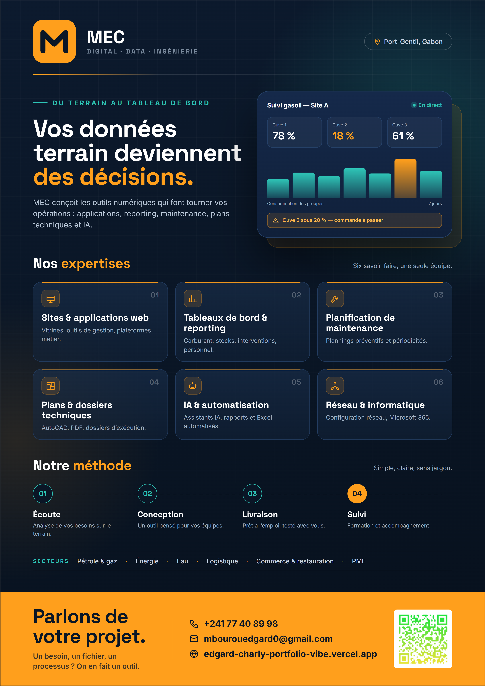
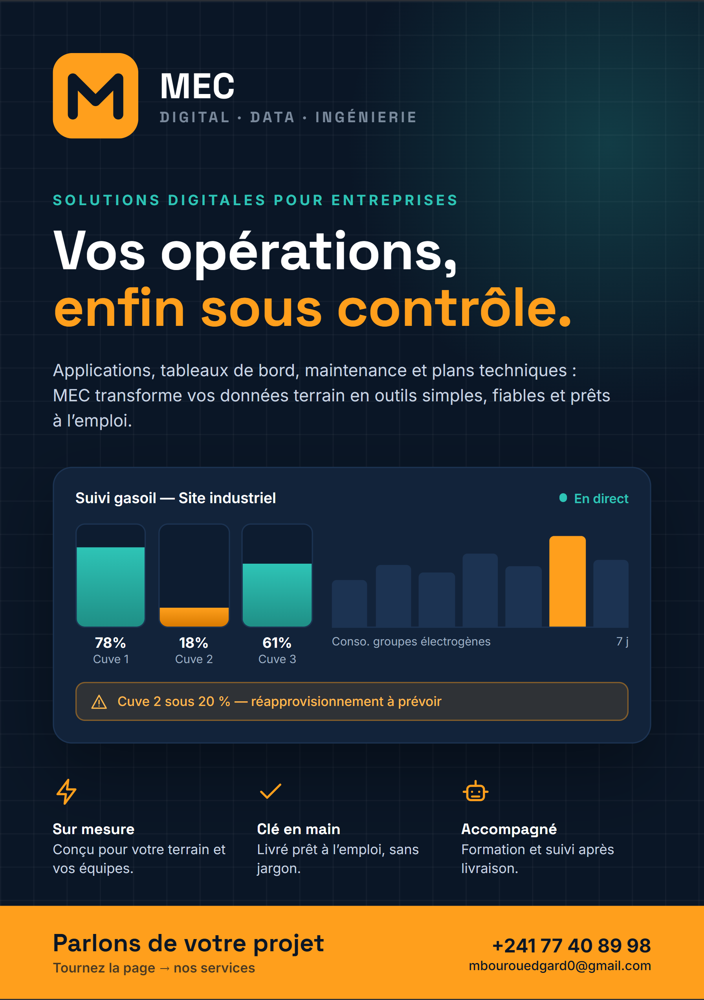
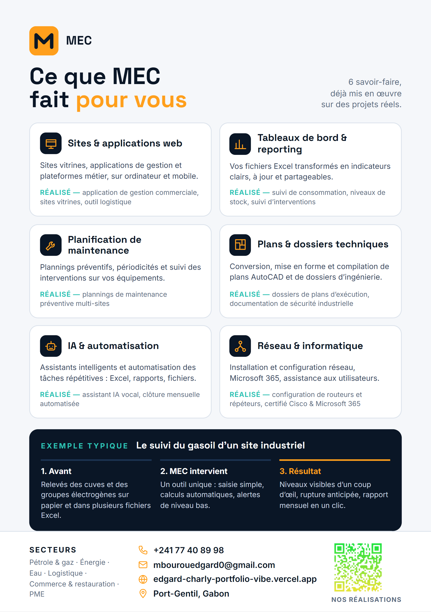

# MEC — Digital · Data · Ingénierie

**Vos opérations, enfin sous contrôle.**

Applications, tableaux de bord, maintenance et plans techniques :
je transforme les données terrain en outils simples, fiables et prêts à l'emploi.

📍 Port-Gentil, Gabon · 🌐 [Portfolio](https://edgard-charly-portfolio-vibe.vercel.app) · ✉️ [mbourouedgard0@gmail.com](mailto:mbourouedgard0@gmail.com)

## 🎬 Présentation vidéo

  
   
  <a href="./MEC_Video_Promo_1080x1920.mp4"><b>▶️ Voir la vidéo (48 s)</b></a>

## 🧰 Ce que je fais

| Domaine | Réalisé |
|---|---|
| 🖥️ Sites & applications web | Gestion commerciale, sites vitrines, outil logistique |
| 📊 Tableaux de bord & reporting | Suivi de consommation, niveaux de stock, interventions |
| 🔧 Planification de maintenance | Plannings préventifs multi-sites |
| 📐 Plans & dossiers techniques | Conversion et compilation de plans AutoCAD |
| 🤖 IA & automatisation | Assistant IA vocal, clôture mensuelle automatisée |
| 🌐 Réseau & informatique | Routeurs, Microsoft 365 — certifié Cisco & Microsoft 365 |

### 📊 Exemple : le suivi gasoil d'un site industriel

**Avant** — relevés des cuves et des groupes électrogènes sur papier et dans plusieurs fichiers Excel.
**MEC intervient** — un outil unique : saisie simple, calculs automatiques, alertes de niveau bas.
**Résultat** — niveaux visibles d'un coup d'œil, rupture anticipée, rapport mensuel en un clic.

## 🏭 Secteurs

`pétrole & gaz` · `énergie` · `eau` · `logistique` · `commerce & restauration` · `PME`

## 📄 Flyer

  
  

---

💬 **Parlons de votre projet** · 📞 +241 77 40 89 98 · ✉️ [mbourouedgard0@gmail.com](mailto:mbourouedgard0@gmail.com)

